# RailWise AI

[简体中文](./README.md) | English

> Engineering survey processing and coding collaboration.

RailWise AI 0.5.6 is a local-first desktop platform for persistent tasks, engineering documents and external-platform work. Code and Survey are the primary workspaces. RailWise Survey connects original observations, calculation records and reviewable deliverables, with Write, Design, Flow, skills and connectors providing supporting tools.

Installers use the `RailWise-AI` name while retaining the existing installation identity and `.workwise` data and configuration readers. Engineering deliverables retain source, calculation and review records for professional assessment. [Release identity and migration notes](./docs/MIGRATION_RELEASE_IDENTITY.zh-CN.md)

- Product page: [www.railwise.cn/products/workwise](https://www.railwise.cn/products/workwise/)
- Direct mirror downloads: [Download and installation](https://www.railwise.cn/products/workwise/#download)
- Documentation: [kb.railwise.cn/products/workwise](https://kb.railwise.cn/products/workwise/)
- Public releases: [GitHub Releases](https://github.com/railwise-cn/railwise-ai/releases)
- Latest stable version: [Download](https://github.com/railwise-cn/railwise-ai/releases/latest), or check for updates in the installed application.

## Current release

Version **[0.5.6](https://github.com/railwise-cn/railwise-ai/releases/tag/v0.5.6)** improves persistent tasks, connector authorization, document delivery and in-app upgrades. [Release notes](./release/release-v0.5.6.md)

| Platform | Installer | Download |
| --- | --- | --- |
| macOS Apple Silicon | `RailWise-AI-0.5.6-mac-Apple-Silicon.dmg` | [Release assets](https://github.com/railwise-cn/railwise-ai/releases) |
| macOS Intel | `RailWise-AI-0.5.6-mac-Intel.dmg` | [Release assets](https://github.com/railwise-cn/railwise-ai/releases) |
| Windows x64 | `RailWise-AI-0.5.6-win-x64.exe` | [Release assets](https://github.com/railwise-cn/railwise-ai/releases) |

GitHub Releases remains the public release log and manual installer source. Signed updater metadata and platform update artifacts are published through the official `railwise.cn` Stable channel. There is currently no Linux client, portable edition, or activation-code flow.

## What changed in 0.5.6

- The **task center** brings together goals, progress, pending actions and results. Follow-up requirements reach the original task, inputs remain queued while paused, and task details expose execution scope, operation receipts and verification results.
- **Skills, Plugins, Connectors** appear in that order, with Skills open by default. Browse engineering tools by source and installation state, connect Feishu and DingTalk separately, and confirm external write targets before execution.
- Four new **engineering skills** cover source inventories, monitoring quality checks and charts, document differences, and meeting notes with action items. The market also provides setup and installation entries for Amap, Zotero and AutoCAD redraw skills.
- An **available update** appears in the lower-left corner. One click starts download, safe saving, installation and restart. The bundled Chinese manual has 13 chapters with search and chapter navigation.

## 0.5.6 Chinese interface

These images show the actual RailWise AI 0.5.6 Chinese light interface at 2560 × 1680. Survey uses a local copy of real COSA planar-network material with 33 points, 11 stations and 160 observations. The datum and results await engineering review. The writing screen uses a demonstration document. Original screenshot content includes the macOS sharing indicator in the upper-left corner. [Capture provenance and file inventory](./docs/images/v0.5.6/capture.json)

The results page shows **network geometry and known points**, with control-network geometry, known-point coordinates and the datum awaiting review.

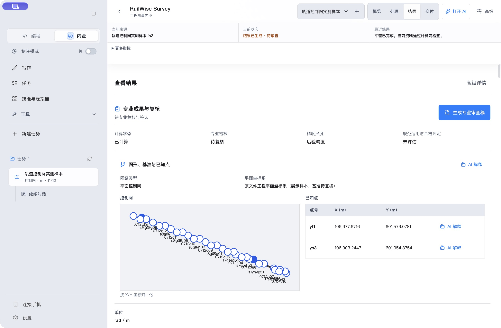

Inspect **adjustment residuals and observation corrections** with original observation rows, calculated values, units and screening status.

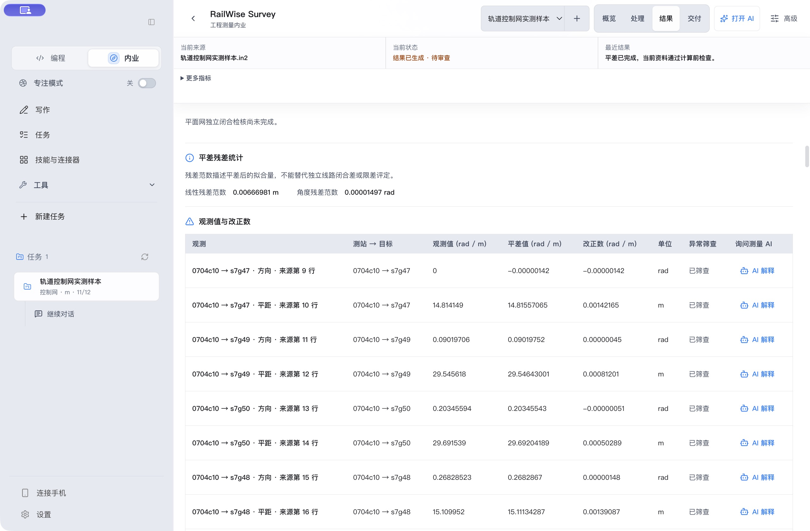

**Deliverables and review** lists DOCX, PDF and XLSX review drafts with preview and export actions and a separate professional-review status.

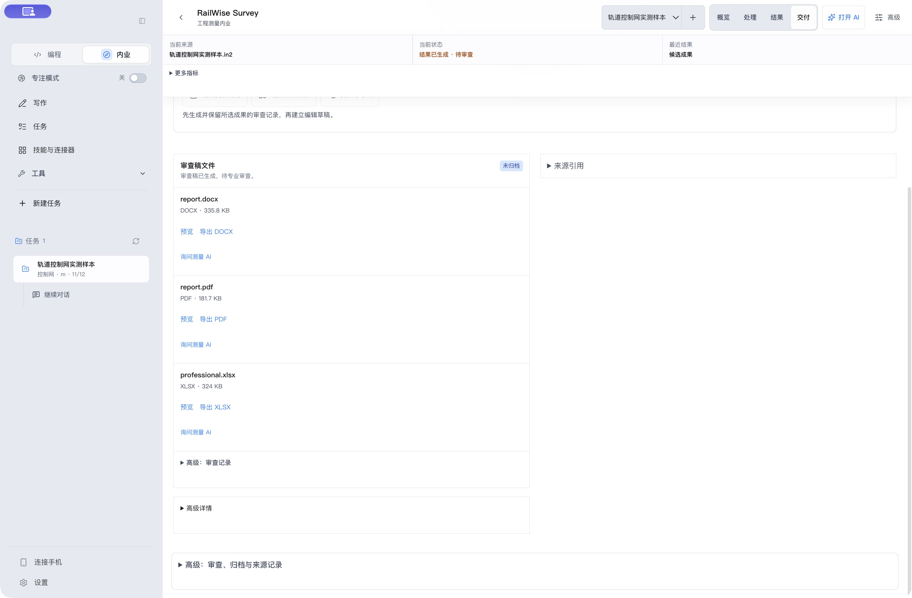

**Task details** show the permissions, completion evidence and operation receipts for a read-only DingTalk task query.

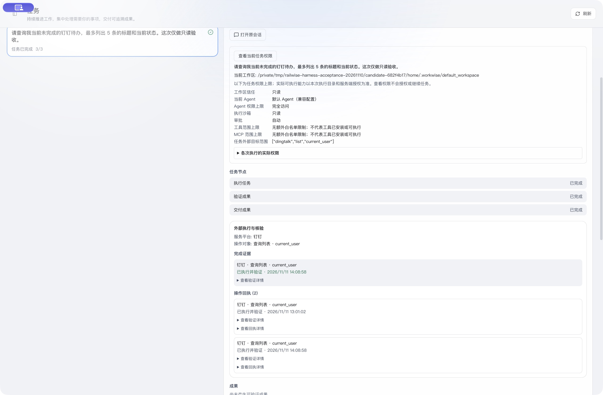

Browse the four **engineering skills** and other indexed skills, with their capabilities and installation state.

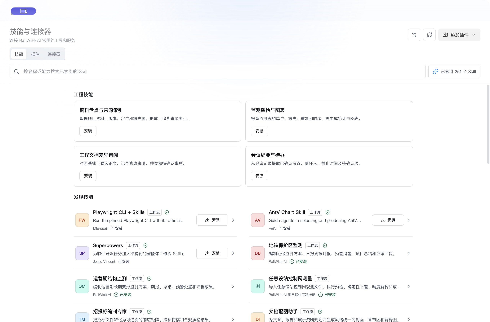

Configure each external platform and inspect its connection and authorization state in **Connectors**.

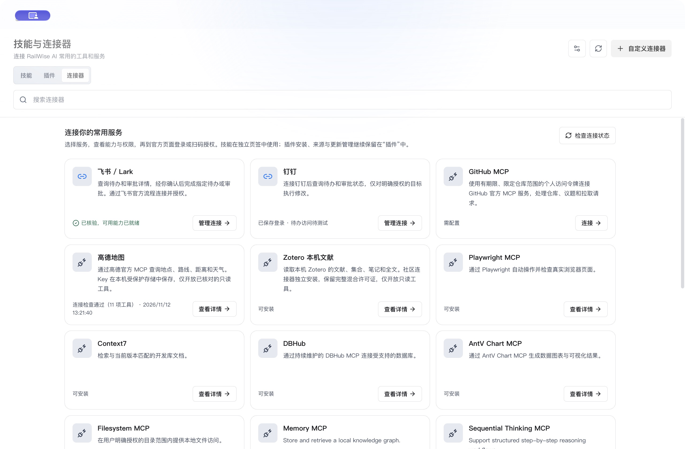

Find the complete Chinese user guide through the chapter list and search in **offline help**.

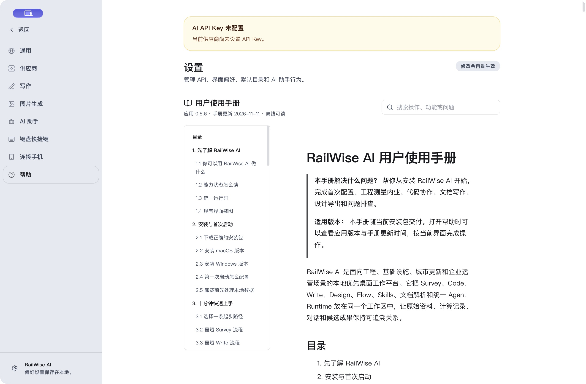

Edit a demonstration review draft in the **writing workbench**, using a source table and flowchart to organize items awaiting confirmation.

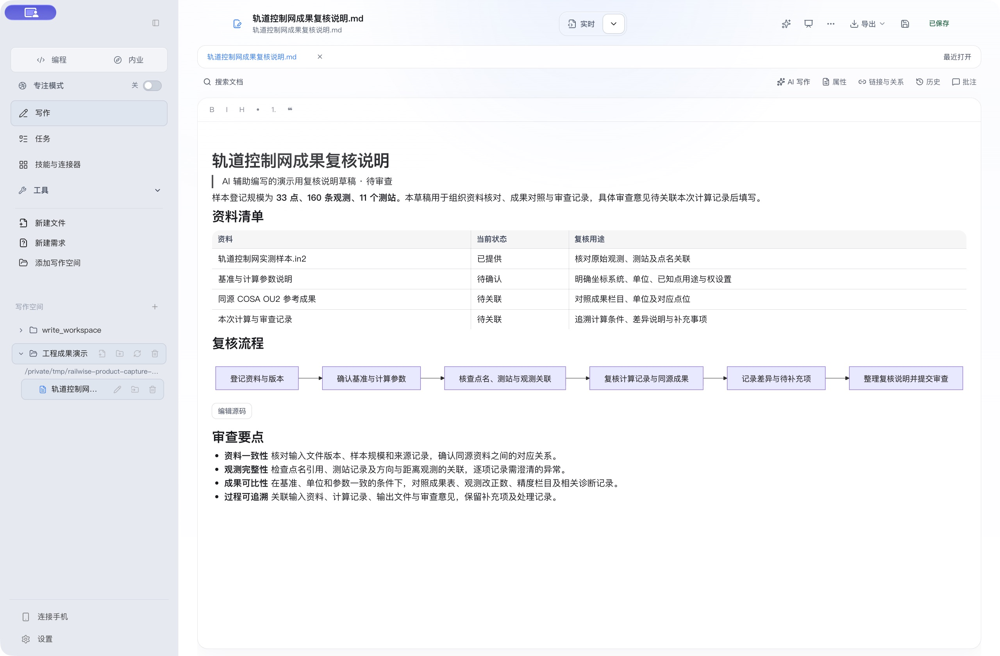

Inspect the upstream source, pinned version, license status and environment requirements of the **CAD redraw skills** before installation. The right panel shows the image-to-CAD skill details.

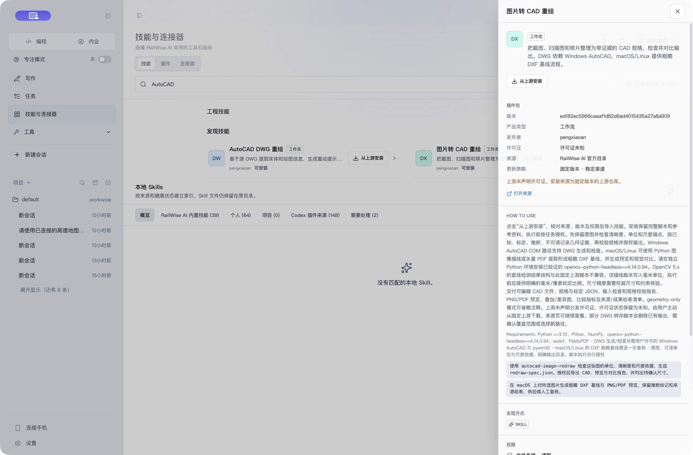

## RailWise Survey

**Original files → Content detection and preflight → Network and datum confirmation → Deterministic adjustment → Precision review → Deliverables → Human review.**

| Production stage | Current workspace functions |
| --- | --- |
| Import and preflight | Content detection, source hashes, diagnostics, original-record anchors and explicit file dispositions |
| Network and adjustment | Confirm network type, control points, units and datum before validated local computation |
| Analysis and precision | Closure, residuals, point precision, XY standard error ellipses and original-record navigation |
| Deliverables and review | DOCX, PDF, XLSX and linked manifests, with fresh source/output reads and strict replay of supported results |

AI conversation continues across stages. Calculations, project changes and exports show concrete parameters for confirmation; AI explanations do not replace deterministic computation. File generation, integrity verification and human approval remain separate states. Candidate deliverables are still review drafts.

COSA IN1/IN2 and Leica GSI leveling inputs must pass the applicable unit, datum and topology checks. Column mappings require explicit confirmation. OU1/OU2 currently remain archival review material, not an accepted automatic comparison workflow. Some formats, including RW5, support inspection or archiving only; receiver observations and RTKLIB-related sources require post-processing and cannot directly substitute for baseline-adjustment inputs. See the [current format matrix](https://github.com/railwise-cn/railwise-ai/blob/e7de9df7c664a4924ea1668e69f821efd0a9bab1/docs/qa/WORKWISE_0.5.0_SURVEY_FORMAT_ACCEPTANCE_MATRIX.md).

Advanced trial workspaces include free leveling, generalized w, grouped VCE, fixed external-scale Huber, statistical families, explicit-reference two-epoch comparison and static independent-observation additions. They retain model declarations, history and strict replay without automatically deleting observations, changing formal weights or declaring reference points stable.

Quality workspaces provide material retention, complete first-round sampling, limited declared-record scoring and linked assessments for up to eight sample units. Missing evidence and vetoes remain separate; these features do not authenticate evidence, resampling, professional signatures or full standards conformity. See the [implementation and acceptance ledger](https://github.com/railwise-cn/railwise-ai/blob/e7de9df7c664a4924ea1668e69f821efd0a9bab1/docs/qa/RAILWISE_SURVEY_CONVERGENCE_STATUS.md) and [advanced-trial contracts](https://github.com/railwise-cn/railwise-ai/blob/e7de9df7c664a4924ea1668e69f821efd0a9bab1/docs/qa/RAILWISE_SURVEY_ADVANCED_TRIALS_BACKEND.md). Publication does not establish complete cross-feature coverage, production certification or professional sign-off.

<details>
<summary>Historical 0.5.1 interface and release record</summary>

**[v0.5.1](https://github.com/railwise-cn/railwise-ai/releases/tag/v0.5.1)** introduced the four-stage Survey workspace, exact evidence questions and declared review records, with fixes for macOS startup, persisted tool-argument summaries and variance-scale explanations.

**Version boundary:** 0.5.1 releases the RailWise AI branding and four-stage Survey workspace. Advanced trials and declared quality records retain their documented limits and do not replace professional acceptance. The repository is now `railwise-cn/railwise-ai`; WorkWise package, storage and update identifiers remain compatible; see the [migration matrix](https://github.com/railwise-cn/railwise-ai/blob/e7de9df7c664a4924ea1668e69f821efd0a9bab1/docs/railwise-ai-migration-matrix.md).

These Chinese light-theme images were captured from the final 0.5.1 candidate, whose renderer is byte-for-byte identical to the formal release using a public synthetic network with four points, one station and five observations. The [screenshot manifest](./website/products/screenshots/workwise/release-051-screenshots.json) records package provenance and hashes.

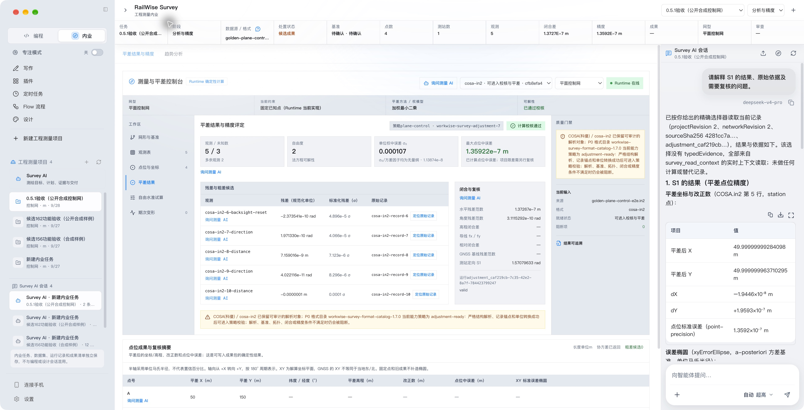

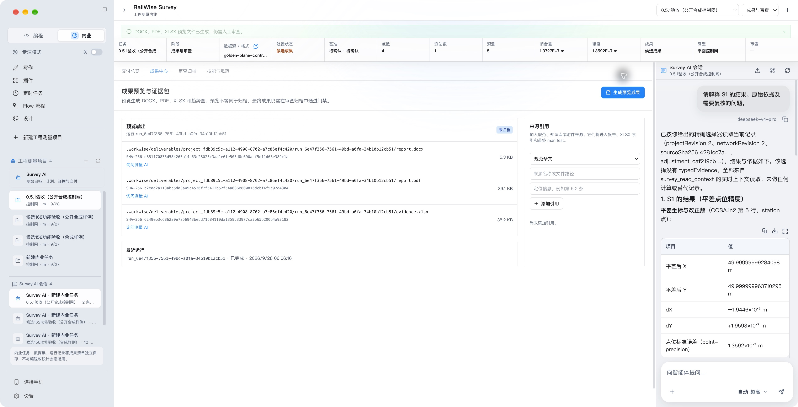

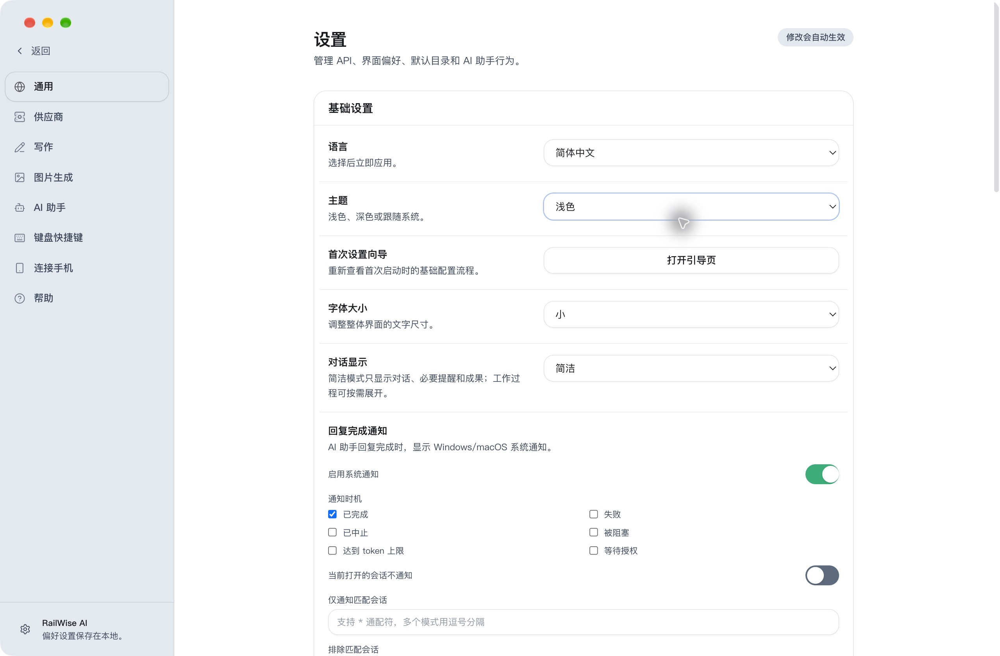

The final candidate passed the full two-hour stability gate and all three client builds. Local acceptance covered signing, notarization, real-model evidence questions, restart/data preservation and DOCX/PDF/XLSX export. A same-source isolated updater completed real download, installation, relaunch and data preservation; it does not certify historical-version migration. See the [0.5.1 release acceptance record](./docs/qa/RAILWISE_0.5.1_RELEASE_ACCEPTANCE.md).

</details>

## DeepSeek V4.1

The default model is DeepSeek V4.1-Flash, using the official ID `deepseek-flash`; automatic mode uses the same model for every task and adjusts thinking effort. Retired selections in scheduled tasks and Claw IM migrate to the current Flash model for the built-in DeepSeek provider; custom-provider model IDs remain unchanged.

On September 20, 2026, real official-service calls through the product adapter passed conversation, JSON output, declared function-name/argument return and synthetic-image recognition checks. The function check did not execute a tool. These checks do not replace acceptance of the complete packaged AI conversation, approval, tool and vision workflows.

The official V4.1 Responses API ignores built-in `web_search`. HTTP 200 does not establish a successful search; use separately configured browser or MCP search tools. See the [real-service evidence and correction](https://github.com/railwise-cn/railwise-ai/blob/e7de9df7c664a4924ea1668e69f821efd0a9bab1/docs/qa/evidence/railwise-v41-live-20260920/README.md).

The model catalog configures a 1M-token context and up to 384K output, with reasoning, tool-call, compression, cache-usage, JSON and Responses adapter paths. Actual access, limits and billing depend on the service and account. Provider vision capability determines structured `text`/`image` messages; text-only providers use the configured loopback visual-evidence analyzer. Failures remain explicit rather than inserting image Base64 into the model prompt. [Official model documentation](https://api-docs.deepseek.com/updates) remains the source for provider capabilities.

## Why RailWise AI

AI should do more than answer a one-off prompt. Real work needs project material, files, sessions, methods, and delivery standards to persist together.

1. **Persistent context**: local workspaces, conversations, and documents stay organized around the same task.
2. **Writing through delivery**: Markdown writing, preview, rich-text copying, and Word / PDF delivery live in one workflow.
3. **Reusable experience**: repeatable methods, templates, and standards can become Skills instead of one-off prompts.
4. **Bounded extensibility**: MCP and plugins add tools and data sources only after their purpose and permissions are understood.

## Core capabilities

### Code workbench

Collaborate around local projects and source material: understand, modify, test, build, review, and deliver. Sessions, plans, todos, goals, and permission settings support longer task chains without replacing human judgment.

### Write workbench

Keep Markdown/MDX files in your local workspace and use a document workflow:

- Open multiple documents, pin tabs, reopen closed documents, and switch between rich text, source, split preview, and preview only.
- Display math, footnotes, and Mermaid diagrams; use the block's **Edit source** action to change the Markdown with a live preview before applying it.
- Search local titles, text, and paths; edit YAML properties and writing stages; inspect broken links, backlinks, document relations, snapshot differences, and local comments.
- Select text for AI rewriting, shortening, expansion, or terminology changes, or draft from workspace sources. Review the proposed difference before accepting it. Manual AI actions remain available when automatic suggestions are off.
- Preserve your draft when an external edit conflicts. Partially loaded large files are read-only to protect the original.
- Export HTML, PDF, or DOCX. Math, footnotes, and diagrams use the same local rendering rules; complex Word equations may use an image fallback. DOCX templates let you customize document styles. Check facts, sources, pagination, and layout before delivery.
- Attach PDF and Office tender sources directly in Write, then start the bundled Tender Master workflow without switching to Code.

Read more: [Write and document export](https://kb.railwise.cn/products/workwise/write-export/).

For the exact WorkWise adapter scope and data boundaries, see the [DeepSeek Harness integration note](./docs/DEEPSEEK_HARNESS.zh-CN.md) (Chinese).

### Document attachments and retrieval

Attach PDF, DOCX, XLSX, PPTX, TXT, Markdown, CSV, PNG, JPEG, or WebP files directly to a conversation. Files are streamed into application-managed storage, validated, parsed locally, split into indexed sections, and retrieved only when needed. Long documents are not inserted wholesale into the initial model context; retrieval results preserve page, worksheet, or slide provenance.

Document content is always treated as untrusted reference material. It cannot override system instructions or grant tool permission. Encrypted, damaged, disguised, or oversized files are rejected with an explicit reason. MarkItDown is bundled for local parsing, while MinerU remains an optional local high-accuracy component for difficult scanned PDFs.

The DeepSeek Harness integration describes the application's own Runtime adapters and evidence paths; it does not mean the upstream Harness repository or every upstream capability is bundled into the client.

### Design workbench

Create multi-page structured canvases with text, shapes, images, layers, groups, undo/redo,
document-scoped Agent conversations, visible selection targets, and revision-safe canvas commands.
Export the active design to PNG or SVG, insert it into Write, or deliver a structurally checked PPTX.

Import a PPTX to open the dedicated slide editor. **Edit**, **Reference**, and **Compare** modes let you
edit supported text, shapes, images, tables, and charts and compare the result with the original.
The original file remains immutable. Complex masters, SmartArt, and unsupported OOXML parts are
retained with explicit protection boundaries. AI changes show the target slide, objects, and scope
before confirmation and can be undone. A saved revision becomes active after package, page,
relationship, and media checks. Reference previews report any degradation; verify complex
animation, fonts, and layout in the intended PowerPoint or WPS environment.

### Flow Preview

Build executable workflows by connecting typed trigger, Agent, retrieval, tool, control, approval, and output nodes. The three-column workbench brings node configuration, mock and single-node tests, publish validation, run history, recovery, and approval resumption into one page. Published flows can be invoked by Agents, schedules, or signed webhooks.

Flow is visible by default and labeled Preview. Nodes that require an unconfigured model, external account, or companion CLI show the missing capability, and flows with unresolved dependencies cannot be published. Restricted code execution and webhook signing, replay protection, and rate limits keep execution within explicit boundaries.

### Skills, plugins and connectors

Open **Skills & Connectors** in the sidebar. The tabs are ordered **Skills, Plugins, Connectors**, with Skills selected by default. Skills provide reusable methods and workflows. Plugin details show sources, versions, installation requirements and current state. Connector details provide setup, login and authorization actions for external accounts and data sources.

The engineering skills cover source inventories, monitoring quality checks and charts, document differences, and meeting notes with action items. The AutoCAD DWG redraw and image-to-CAD skills use pinned upstream versions. DWG workflows require Windows and AutoCAD. macOS/Linux can use the coarse DXF workflow.

Feishu and DingTalk have separate task and approval tools. Feishu also supports confirmed message sending and cloud-drive uploads. GitHub MCP uses protected token storage, Amap requires an API key, and Zotero provides read-only access to local references. Available operations depend on installation, account authorization and task permissions. External writes require target confirmation and retain receipts and verification results.

Bundled PPT Master uses a fixed 6.8.0 snapshot for creating and editing PowerPoint files from Markdown, reports, web pages, or an existing PPTX. Give the Write or Design assistant your source, audience, and slide count to begin. Core workflows, scripts, references, and lightweight templates are included; large asset libraries, user projects, generated exports, and backups are excluded.

Read more: [Skills and templates](https://kb.railwise.cn/products/workwise/templates/).

### Local first

Workspaces, sessions, and settings are centered on the local machine. Model calls use API keys or compatible services that you are authorized to use. Handle sensitive material, access permissions, and local cleanup according to your organization’s rules.

Read more: [Local data and security](https://kb.railwise.cn/products/workwise/security-data/).

## Capability status

| Status | Scope |
| --- | --- |
| Available now | Code, Write, Design, DeepSeek Harness structured attachment handling, reliable task runs, Agents, MCP V2, general document attachments, indexed retrieval, validated document delivery, and in-app updates |
| Survey | Four-stage workspace, exact evidence questions, bounded advanced trials and declared quality records; professional applicability, signatures and full standards certification remain separate |
| Preview | Flow canvas, typed nodes, mock and single-node tests, publish validation, run history, approval, and failure recovery |
| Optional | Local MinerU parsing, online Skill updates, mobile connection, and companion command-line tools |
| Direction | More multimodal generation nodes, industry nodes, and enterprise integrations |

Preview and directional items are not described as stable released features.

## Quick start

1. Download the installer that matches your device and install it.
2. Configure DeepSeek, Agnes AI, or another OpenAI-compatible service in Settings.
3. Choose a local project or source-material directory as a workspace.
4. Start in Code or Survey. Engineering tasks use the four-stage Survey workspace; Write, Design and Flow Preview remain available as supporting tools.
5. Open Flow Preview when automation is useful, then review content, images, tables, and layout before formal delivery.

- [Quick start](https://kb.railwise.cn/products/workwise/quickstart/)
- [Installation guide](https://kb.railwise.cn/products/workwise/install-guide/)
- [FAQ](https://kb.railwise.cn/products/workwise/faq/)

### Installation notes

- **macOS**: When macOS shows a first-open security prompt, verify the installer source first. You can allow the app in System Settings > Privacy & Security; the installation guide includes a fallback `xattr` path when needed.
- **Windows**: When Defender or SmartScreen appears, verify the source, file name, and version before continuing under your organization’s security policy.
- **Model services**: API-key availability, quotas, model access, and billing are controlled by the provider and your account.

### In-app updates

RailWise AI 0.5.6 checks the official `railwise.cn` Stable channel at startup and every 24 hours. When an update is available, a compact **Upgrade** control appears at the lower left of the standard and writing sidebars and displays download progress.

One click starts download and verification, saves edited content, and waits for a safe execution boundary before installing and restarting. Save or shutdown failures show a reason and a retry action. Tasks, drafts, history and configuration references are preserved across upgrades, including paused and waiting tasks. The release completed a native upgrade test from formal 0.5.4 to the exact 0.5.6 package.

Manual checking, channel selection and diagnostics remain available in Help or Settings. The Help center bundles the complete 13-chapter Chinese manual for offline reading, full-text search, chapter navigation and internal links. [Complete user guide](./docs/USER_GUIDE.zh-CN.md)

Version 0.3.2 and earlier did not include the trusted production update channel, so those users need one final manual installation of 0.3.3. Subsequent stable releases can update in the application.

## Development

```bash
git clone https://github.com/railwise-cn/railwise-ai.git
cd railwise-ai
npm install
npm run dev
```

Common quality checks:

```bash
npm run openspec:validate
npm run verify:brand-boundary
npm run typecheck
npm run lint
npm run test
npm run build
```

The local agent is provided by WorkWise Agent Runtime through a stable HTTP/SSE boundary with the desktop application.

## Release policy

- Public GitHub Releases expose the macOS Apple Silicon DMG, macOS Intel DMG,
  and Windows x64 EXE. ZIP, blockmap, signed update metadata, and checksums are
  published through the official `railwise.cn` update channel.
- Intermediate build artifacts are not published, and unverified roadmap items are not presented as released capabilities.
- [GitHub Releases](https://github.com/railwise-cn/railwise-ai/releases) is the public release log. Stable promotion requires the exact version's release approval after packaged acceptance, including signing, notarization and a real updater round trip; passing CI alone is not approval.
- The historical 0.2.5 public behavior baseline is tracked in the [public behavior gap table](docs/PUBLIC_BEHAVIOR_GAP_0.2.5.zh-CN.md).

## Feedback

Please report issues or ideas through [GitHub Issues](https://github.com/railwise-cn/railwise-ai/issues). Include where possible:

- WorkWise version, operating system, and chip architecture.
- Reproducible steps, screenshots, or error logs.
- A minimal Markdown example for document-export issues.
- The source, trigger, and error message for Skills or MCP issues.

## License

[MIT](./LICENSE)
