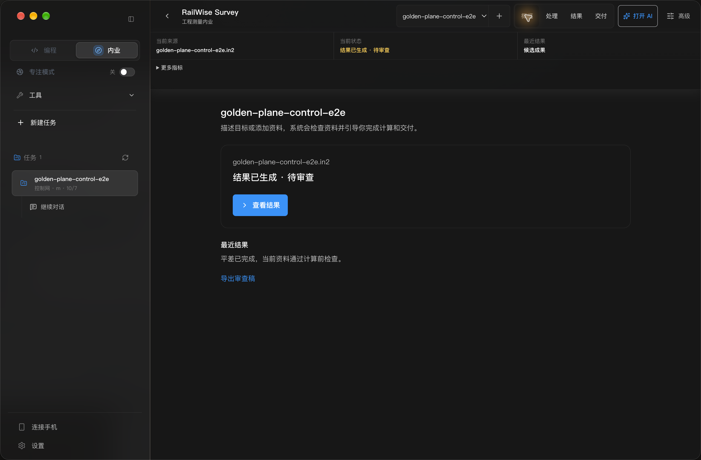
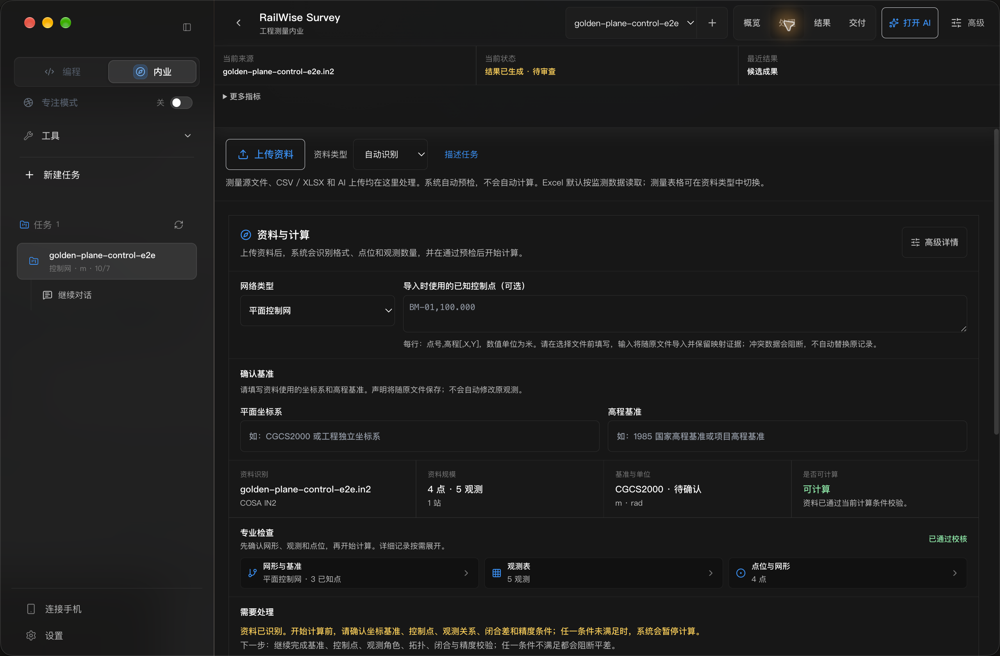
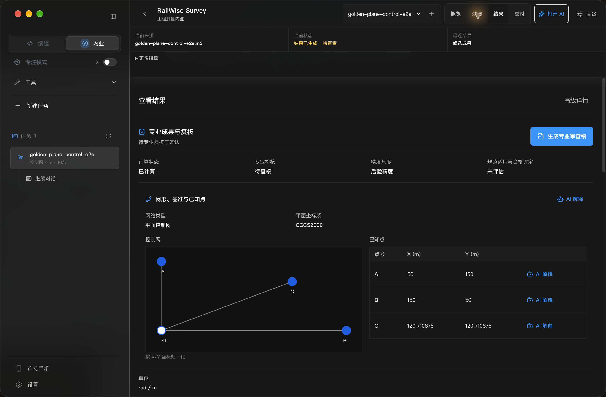
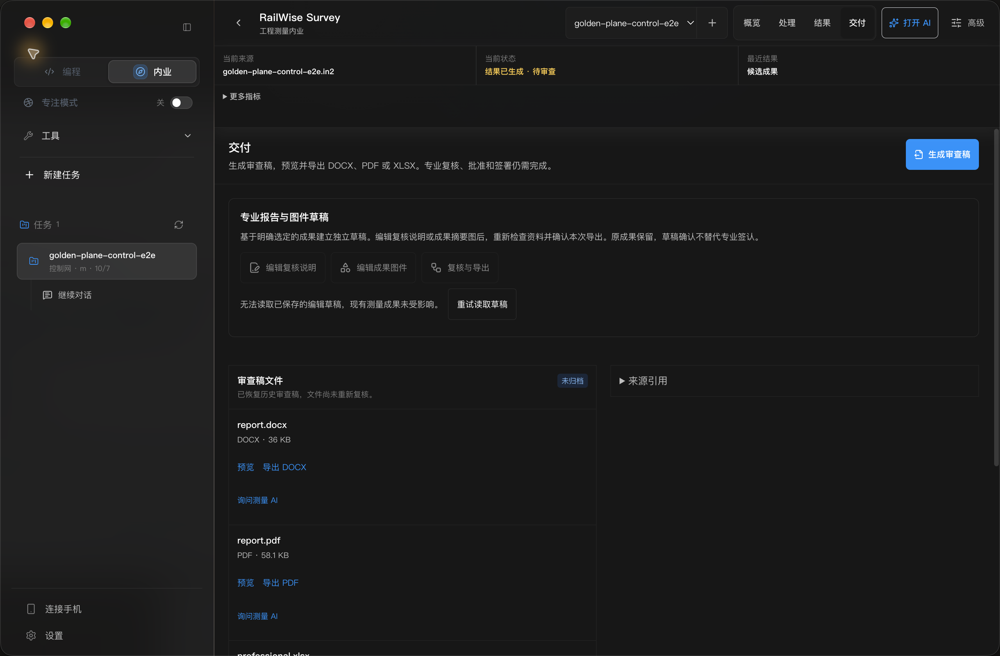
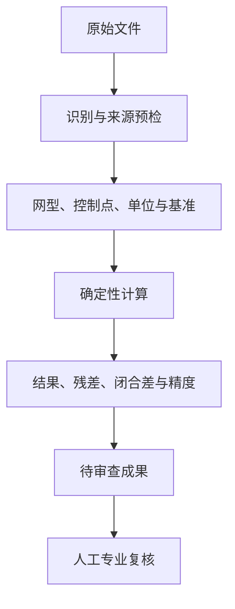

# RailWise AI 用户使用手册

> **本手册解决什么问题？** 帮你从安装 RailWise AI 开始，完成首次配置、工程测量内业、代码协作、文档写作、设计导出和问题排查。
>
> **适用版本：** 本手册随当前安装包交付。打开帮助时可以查看应用版本与手册更新时间，按当前界面完成操作。

RailWise AI 是面向工程、基础设施、城市更新和企业运营场景的本地优先桌面工作平台。它把 Survey、Code、Write、Design、Flow、Skills、文档解析和统一 Agent Runtime 放在同一个工作区中，让原始资料、计算记录、对话和候选成果保持可追溯关系。

## 目录

- [1. 先了解 RailWise AI](#1-先了解-railwise-ai)
- [2. 安装与首次启动](#2-安装与首次启动)
- [3. 十分钟快速上手](#3-十分钟快速上手)
- [4. Survey：从原始资料到待审查成果](#4-survey从原始资料到待审查成果)
- [5. Code：从任务到可审查的修改](#5-code从任务到可审查的修改)
- [6. Write：从草稿到正式文档](#6-write从草稿到正式文档)
- [7. Design：从画板到图片和演示文稿](#7-design从画板到图片和演示文稿)
- [8. Flow Preview、定时任务与连接手机](#8-flow-preview定时任务与连接手机)
- [9. 附件、模型与扩展能力](#9-附件模型与扩展能力)
- [10. 常见问题](#10-常见问题)
- [11. 故障排查](#11-故障排查)
- [12. 版本更新](#12-版本更新)
- [13. 本地数据、隐私与反馈](#13-本地数据隐私与反馈)

---

## 1. 先了解 RailWise AI

### 1.1 你可以用 RailWise AI 做什么

| 你的任务 | 从哪里开始 | 主要产物 |
| --- | --- | --- |
| 处理控制网、水准、变形监测和成果复核 | **内业 / Survey** | 计算结果、复核记录、DOCX/PDF/XLSX 待审查成果 |
| 理解项目、修改文件、运行测试和审查变更 | **Code** | 可查看的计划、Diff、任务记录和验证结果 |
| 编写方案、报告、标书和知识文档 | **Write** | Markdown、HTML、PDF、DOC、DOCX |
| 制作流程图、信息图和演示页面 | **Design** | PNG、SVG、原生 PPTX 或 Write 插图 |
| 把多个步骤连成可运行流程 | **Flow Preview** | 流程定义、运行历史、审批记录和输出文件 |
| 复用方法、模板和行业流程 | **Skills** | 可启用、禁用和更新的本地能力 |

### 1.2 能力状态怎么读

| 标签 | 含义 | 使用建议 |
| --- | --- | --- |
| 稳定能力 | 已纳入产品工作流的能力 | 可以用于日常任务，但正式交付仍需按组织流程复核 |
| Survey | 面向工程测量内业的专业工作区 | 计算由确定性服务生成，AI 负责解释、追问和编排 |
| Preview | 正在完善的流程能力 | 先用样例或低风险任务验证，再用于真实流程 |
| 可选能力 | 需要额外安装、配置或外部账号 | 使用前确认网络、权限、额度和数据边界 |

**关键边界：** AI 的解释、摘要和建议不能代替原始资料核验、计算复核、专业签认或规范符合性判断。Survey 中的坐标、残差、闭合差和精度由计算服务生成；候选成果必须由有权限的专业人员审阅后才能进入正式交付。

### 1.3 统一运行时

RailWise AI 使用一个内置的 本机任务执行服务。Code、Write 和连接手机共用同一运行时边界，因此模型配置、权限提示、工具审批和任务恢复的行为保持一致。

你不需要在多个运行时之间切换。遇到外部工具或高风险命令时，先阅读权限提示，再决定批准、拒绝或取消。

### 1.4 现有界面截图

以下截图来自 RailWise AI 0.5.3 候选包的中文深色验收记录，用于认识工作区布局；具体按钮、版本号和状态以当前安装包为准。完整验收记录见 [`docs/qa/release-gates/v0.5.3/`](./qa/release-gates/v0.5.3/)。

以上为历史版本的 Survey 界面示例。当前功能以安装包中的可用入口和能力状态为准。

---

## 2. 安装与首次启动

### 2.1 下载正确的安装包

只从 [RailWise AI 产品主页](https://www.railwise.cn/products/railwise-ai/) 或 [GitHub Releases](https://github.com/railwise-cn/railwise-ai/releases) 下载。历史 0.5.3 的版本记录可从 [v0.5.3 发布页](https://github.com/railwise-cn/railwise-ai/releases/tag/v0.5.3)进入。

| 电脑 | 安装包命名 |
| --- | --- |
| macOS Apple 芯片 | `RailWise-AI-版本号-mac-Apple-Silicon.dmg` |
| macOS Intel 芯片 | `RailWise-AI-版本号-mac-Intel.dmg` |
| Windows 64 位 | `RailWise-AI-版本号-win-x64.exe` |
| Linux | 当前不提供桌面客户端 |

下载前确认两点：

1. macOS 的芯片类型与安装包一致；
2. 发布页上的版本号与组织要求一致，不要把开发包或未签名包当作正式安装包。

### 2.2 安装 macOS 版本

1. 打开下载的 `.dmg` 文件。
2. 将 RailWise AI 拖入 **Applications / 应用程序**。
3. 从应用程序启动 RailWise AI。
4. 如果系统显示开发者或文件来源提示，先确认安装包来自官方发布页；不要把未知来源的副本加入系统信任。
5. 首次启动完成后，在 **设置 → 通用** 检查版本号和更新状态。

**完成检查：** 能看到主工作区、侧边栏入口和设置页面；没有反复弹出安装权限提示。

### 2.3 安装 Windows 版本

1. 双击 `RailWise-AI-版本号-win-x64.exe`。
2. 按安装向导选择安装位置。
3. 安装完成后从开始菜单或桌面快捷方式启动。
4. 首次启动完成后，打开 **设置 → 通用** 检查版本号和更新状态。

**完成检查：** 能打开主工作区，并可以创建或选择一个本地工作区。

### 2.4 第一次启动怎么配置

按以下顺序完成配置：

1. 选择界面语言、主题和字体大小。
2. 打开模型设置，填写你有权使用的 DeepSeek API Key，或配置兼容 OpenAI/DeepSeek 协议的服务。
3. 需要其他服务时填写 Base URL，并选择默认模型。
4. 选择默认工作区。工作区是项目文件、会话和可审查任务的边界。
5. 打开 **设置 → 通用 → 软件更新**，执行一次手动检查。

默认 DeepSeek 配置使用官方地址 `https://api.deepseek.com`。当前默认模型是 `deepseek-flash`；已经保存的显式模型选择会保留。Agnes AI 通过模型供应商配置接入，账号、额度、计费和可用模型以服务商规则为准。

没有 API Key 时，仍然可以使用本地 Markdown 编辑、预览、历史、批注、部分导入和导出能力；需要模型的对话、AI 写作和 AI 解释会提示配置模型。

### 2.5 卸载前先处理本地数据

卸载应用不会自动删除历史会话、工作区、MCP 配置、Skills 或日志。如果电脑还要继续使用 RailWise AI，直接卸载应用即可；如果要彻底清理，请先备份并确认不再需要这些数据，再按操作系统删除应用数据目录。

默认数据位置包括：

| 数据 | 默认位置 |
| --- | --- |
| 默认工作区 | `~/.workwise/default_workspace` |
| Write 工作区 | `~/.workwise/write_workspace` |
| Runtime 与会话 | `~/.workwise/runtime` 或系统应用数据目录 |
| Agent 配置 | `~/.workwise/agents` 与工作区 `.workwise/agents` |
| 工具缓存 | `~/.workwise/tools` 与工作区 `.workwise/cache` |
| macOS 设置 | `~/Library/Application Support/RailWise AI/workwise-settings.json` |
| Windows 设置 | `%APPDATA%\\RailWise AI\\workwise-settings.json` |

升级时保留旧 `WorkWise` 等兼容目录及设置读取能力。不要手动改名配置文件或删除旧目录；自定义数据位置以应用设置和实际日志目录为准。

---

## 3. 十分钟快速上手

### 3.1 选择一条起步路径

| 你现在想完成的事 | 推荐路径 |
| --- | --- |
| 先确认应用能正常工作 | 新建工作区 → 配置模型 → Code 发一个只读问题 |
| 处理测量资料 | 内业 → 新建任务 → 处理 → 结果 → 交付 |
| 写一份报告 | Write → 新建 Markdown → 添加参考资料 → AI 写作 → 导出 |
| 做一页图或 PPT | Design → 新建画板 → 添加元素 → 导出 PNG/SVG/PPTX |

### 3.2 最短 Survey 流程

1. 进入 **内业**，创建或选择一个任务。
2. 在 **处理** 页上传原始资料。
3. 查看识别结果、点位和观测数量、已知点、单位、网型与基准。
4. 处理所有阻断提示；缺少控制条件时先补资料，不要直接跳过。
5. 开始计算，在 **结果** 页查看坐标、高程、残差、闭合差和精度。
6. 在结果行旁选择 **询问测量 AI**，提出一个带点号或观测编号的具体问题。
7. 进入 **交付**，生成待审查成果，检查警告后导出 DOCX、PDF 或 XLSX。

**成功标准：** 你能在同一个任务中找到原始资料、计算结果、AI 解释和成果文件，并能说明每个结论需要谁复核。

### 3.3 最短 Write 流程

1. 从左侧文件树打开或创建 Markdown 文件。
2. 在顶部模式菜单选择 **富文本**、**源码编辑**、**分栏预览** 或 **仅预览**。
3. 用右侧助手的加号添加 PDF、Office、文本或图片资料。
4. 选中需要修改的段落，选择 **AI 写作** 操作。
5. 在 **审阅 AI 修改** 中检查差异，再选择接受或放弃。
6. 先保存，再切换到 **仅预览**，最后导出 HTML、PDF、DOC 或 DOCX。

### 3.4 最短 Code 流程

1. 选择工作区并说明目标、范围和验收条件。
2. 需要先讨论方案时使用 `/plan`。
3. 涉及文件修改、命令或外部服务时阅读审批提示。
4. 在时间线中查看文件变更和 Diff。
5. 运行测试或验证命令。
6. 只把已经检查过的结果交给下一位协作者。

---

## 4. Survey：从原始资料到待审查成果

### 4.1 Survey 的工作顺序

Survey 保留原始文件、来源身份、解析诊断、计算记录和成果修订。AI 可以解释和组织下一步，但不会把未经确认的观测、坐标或精度数字悄悄改写。

### 4.2 导入与预检

1. 在 **内业** 中创建任务，填写项目名称和必要的上下文。
2. 在 **处理** 页添加文件。
3. 阅读文件识别结果和诊断，不要只看扩展名判断格式。
4. 核对点位、观测数量、仪器来源、单位和解析器提示。
5. 需要列映射或单位转换时，先确认映射内容，再继续。
6. 对加密、损坏、伪装格式、超限文件或不完整解析，按界面提示重新提供资料。

支持范围取决于当前安装包和具体来源。COSA IN1/IN2、Leica GSI 水准等数据必须通过单位、基准和拓扑校验；RW5、GNSS 原始观测和部分 RTKLIB 来源可能只支持解析检查、归档或后处理，不能直接当作具备基准与协方差的平差输入。

### 4.3 确认网型、控制点和基准

在开始计算前，确认：

- 网型与实际观测关系一致；
- 已知控制点确实有可用的坐标或高程；
- 坐标系、投影、单位和高程基准已声明；
- 观测单位、权重和仪器信息没有混用；
- 计算对象与当前任务绑定，没有误选历史成果。

当界面提示缺少控制条件、基准冲突、拓扑不完整或精度条件不满足时，先修正资料或任务配置。读取文件成功不等于资料已经满足计算条件。

### 4.4 查看结果并询问测量 AI

进入 **结果** 页后，按以下顺序检查：

1. 先看计算状态和阻断提示；
2. 再看点位、观测残差和闭合差；
3. 最后看精度、异常标记和原始记录定位。

结果行旁的 **询问测量 AI** 适合回答带范围的问题，例如：

- “解释 S1 的平差坐标、点位精度和需要复核的问题。”
- “这条观测残差对应原始记录哪一行？应先检查什么？”
- “本次闭合差使用什么单位，是否超过当前设置的限值？”
- “生成待审查报告前还有哪些问题没有解决？”

提问时写清点号、观测编号、成果文件或时间范围。AI 回答应与结果表、原始资料和项目限值交叉核对；资料发生变化或模型连接失败时，重新选择当前记录后再问。

### 4.5 生成成果并完成审查

1. 进入 **交付** 页。
2. 选择要生成的 DOCX、PDF 或 XLSX 类型。
3. 查看资料范围、日期、结论、警告和关联清单。
4. 打开生成文件，检查分页、表格、单位和引用。
5. 将文件标记为待审查草稿，按组织流程完成实际专业签认。

**不要仅凭“已完成”判断交付成功。** 应在成果卡中使用 **打开**、**另存为** 或 **显示位置**，确认文件真实存在并且格式验证通过。

### 4.6 Survey 中不能自动替你做的判断

以下判断仍需要有权限的专业人员完成：

- 已知点是否可靠、基准是否适用；
- 观测是否真实、完整和符合项目要求；
- 结果是否满足适用规范和合同限值；
- 质量问题是否需要返工、重测、整改或重新抽样；
- 报告是否可以签发或作为正式工程成果使用。

XY 标准误差椭圆、闭合差和残差的数值含义必须结合项目单位、模型和限值解释；单一数值达标不能自动证明整个成果合格。

---

## 5. Code：从任务到可审查的修改

### 5.1 什么时候使用 Code

Code 适合项目开发、代码审查、需求拆解、资料整理和自动化执行。它围绕真实工作区运行，能够读取文件、提出计划、申请工具、修改文件并运行验证。

### 5.2 一次完整的 Code 任务

1. 选择正确的工作区。
2. 写清楚目标、不能修改的范围和验收条件。
3. 需要先拆解时输入 `/plan`。
4. 对文件写入、外部网络、包安装或敏感命令逐项阅读审批。
5. 在时间线查看读取、修改、测试和成果。
6. 通过 Diff 检查改动是否只涉及当前任务。
7. 运行项目已有的测试或验证命令。
8. 让 AI 总结已完成内容、未完成事项和验证证据。

### 5.3 审查已有改动

使用 `/review` 后，明确审查范围：当前工作区、指定分支或指定 commit。重点查看：

- 是否改变了用户可见行为；
- 是否引入权限、数据覆盖或路径越界风险；
- 是否缺少回归测试；
- 是否把 Preview 或实验能力写成稳定能力；
- 是否保留了迁移兼容和旧数据读取路径。

### 5.4 任务暂停、恢复和停滞

任务达到单次尝试的步骤或时间上限时，RailWise AI 会保存 checkpoint 并继续内部尝试。应用重启后，可安全重试的任务会恢复；涉及不确定外部副作用时会先请求确认。

任务可能因审批、必要输入、安全阻断、预算耗尽、不可恢复错误或主动取消而暂停。连续无进展时会进入 **已停滞**，此时可以继续、换模型或调整要求；不要把阶段性文字当作最终交付。

### 5.5 对话显示模式

| 模式 | 适合谁 | 显示内容 |
| --- | --- | --- |
| 简洁 | 日常使用 | 对话、短进度、审批、错误和成果 |
| 标准 | 需要了解过程 | 语义操作，如读取文件、验证文档 |
| 开发者 | 调试和审查 | 脱敏命令摘要、Diff、输出和指标 |

日常执行以简短状态反馈。脚本参数、长输出、绝对路径和请求头保留在可展开的 **工作详情** 中，浏览器审批的技术指纹可在 **执行详情** 中查看。审批卡直接展示需要核对的站点、动作、目标和输入，密钥与敏感字段经过脱敏。

### 5.6 交付 HTML 报告与查看成果

在任务中写清楚资料来源、报告内容和输出格式。可以说明“读取指定网页，生成附来源链接的 HTML 报告”。

1. 等待任务生成、登记并核验实际成果文件。
2. 当前会话的首个已核验 HTML 成果会自动打开右侧预览。
3. 从任务中心查看成果，或主动关闭预览后需要再次查看时，点击成果卡中的文件重新打开。
4. 核对正文、来源链接、文件位置和验证状态。文件更新后按最新内容重新打开预览。
5. 若任务仍有待授权、缺失来源或结果待核实事项，先处理对应待办，再核对最终交付状态。

只读工作区中的新报告可以保存到 **应用任务成果**，文件与当前任务关联。任务需要写入你指定的项目目录时，会展示目标路径并申请写入范围。核对工作区、路径、有效期和授权方式后确认，再单独继续原任务。成果卡和任务详情会显示实际保存位置。

---

## 6. Write：从草稿到正式文档

### 6.1 文档和标签

1. 在左侧文件树打开 Markdown/MDX 文件。
2. 点击标签切换文档；点击图钉固定常用文档。
3. 使用 **最近打开** 找回文档，使用 **恢复关闭** 重新打开最近关闭的文档。
4. 关闭未保存文档时，选择 **保存并关闭**、**放弃更改并关闭** 或 **取消**。
5. 文件树支持创建、重命名、移动和删除；移动时选择工作区内文件夹，不会覆盖同名目标。

### 6.2 选择编辑模式

| 模式 | 用途 |
| --- | --- |
| **富文本 / Rich text** | 直接修改段落、标题、列表、引用和常用格式 |
| **源码编辑 / Source editor** | 调整完整 Markdown、表格、代码、链接和高级语法 |
| **分栏预览 / Split preview** | 左侧编辑、右侧预览，适合长文校对 |
| **仅预览 / Preview only** | 导出前阅读最终效果 |

富文本中的公式、脚注和 Mermaid 块旁会出现 **编辑源码**。如果活动文档或原文在预览期间变化，应用会要求重新打开编辑器，以免覆盖新内容。

### 6.3 搜索、属性、链接、历史和批注

- **搜索文档：** 按标题、正文或路径搜索，结果显示匹配片段和行号。大文件被跳过或截断时，不能把不完整结果当作“没有匹配”。
- **属性：** 编辑 YAML frontmatter，填写 `title`、`tags` 和写作阶段。阶段只用于整理，不会自动发布。
- **链接：** 检查断链、路径越界、反向链接和工作区链接关系；可在源码中使用相对路径（例如 `./方案.md`）或 `[[方案]]` 建立关系。
- **历史：** 先查看快照差异，再恢复指定版本。恢复会新增记录，后续历史仍保留。
- **批注：** 选中文字后保存独立批注。批注不写入 Markdown，可解决、重新打开或加入 AI 写作队列；原文变化后会提示锚点变化。

### 6.4 使用 AI 写作

1. 选中要处理的段落，打开 **AI 写作**。
2. 选择改写、压缩、扩写、正式报告风格或术语统一。
3. 需要利用本地资料时，选择 **根据工作区资料撰写（附来源）**。
4. 等待结果进入 **审阅 AI 修改**。
5. 对照增删差异，选择 **接受修改** 或 **放弃修改**。

生成期间如果原文发生变化，需要重新生成后再审阅。AI 写作需要可用模型；没有模型时，继续使用手动编辑和本地预览。

### 6.5 公式、脚注和 Mermaid

公式支持 `$...$`、`\\(...\\)`、`$$...$$`、`\\[...\\]` 以及 `math`/`latex` 围栏。错误或过长公式会保留源码并显示提示。

脚注使用 `正文[^说明]` 与 `[^说明]: 脚注内容`，也支持 `^[行内说明]`。预览中的编号可以跳到脚注，回链返回原引用。

Mermaid 使用 `mermaid` 围栏，例如：

图表在本地隔离渲染，远程资源、图片、点击回调和初始化指令被禁用。语法错误时保留原始源码并显示提示。

### 6.6 添加资料并检索来源

右侧助手的加号支持 PDF、DOCX、XLSX、PPTX、TXT、Markdown、CSV 和图片。解析完成后，可按 PDF 页码、工作表、幻灯片、标题或表格检索来源。

文档内容按不可信资料处理，不能覆盖系统指令或替代工具授权。加密、损坏、伪装格式和超限文件会明确报错。

### 6.7 导出 HTML、PDF、DOC 和 DOCX

| 格式 | 适合场景 | 导出后检查 |
| --- | --- | --- |
| HTML | 网页阅读和内部预览 | 图片路径、链接和代码块 |
| PDF | 固定版式交付 | 分页、字体、表格和图表尺寸 |
| DOC | 交给 Word/WPS 继续编辑 | 样式、分页和兼容性 |
| DOCX | 正式 Word 文档 | 表格、图片、字体和模板效果 |

导出时遵循以下规则：

- DOCX 使用 RailWise AI 内置生成器，不要求另装 Pandoc；
- 相对路径图片按当前 Markdown 文件所在目录解析，且必须在当前工作区内；
- 默认只读取本地图片，不下载远程图片；
- YAML frontmatter 保留在 Markdown 源文件中，不作为正文写入导出文件；
- 复杂公式、特殊表格、Mermaid 尺寸和跨平台字体仍需打开结果文件复核。

DOCX 内置模板包括学术论文、行政公文、商务报告和技术文档。可以调整标题、正文、表格、代码块的字体、字号、颜色、行距、对齐和缩进，再另存为自定义模板。特殊字体未安装时，Word 会使用系统字体兜底。

### 6.8 外部编辑冲突和大文件

如果外部编辑器修改了同一文件，保存时会显示 **磁盘版本** 和 **当前草稿**。选择 **采用磁盘版本** 或 **保留草稿，继续编辑**，不要在不阅读差异时强行覆盖。

如果文件已被外部移动或改名，使用 **重新定位** 输入工作区内的新路径，并在定位后审阅内容差异。

大文档可能切换为源码安全模式；如果提示“只载入了部分内容”，文档会只读并禁用保存，避免把片段覆盖回完整文件。请拆分文档或使用外部编辑器处理完整文件。

---

## 7. Design：从画板到图片和演示文稿

### 7.1 创建和保存画板

Design 是结构化 SVG 画板，支持多页、文本、基础形状、图片、路径、PowerPoint preset 和真实 group。编辑会保存到当前工作区的 `.workwise/design`，重启后可以恢复活动文档。

1. 创建或打开 Design 文档。
2. 添加页面、文本、形状、图片或路径。
3. 用组合、取消组合、撤销和重做整理画面。
4. 选中元素后再让 Design 助手修改，确认目标页、目标元素和影响范围。
5. 切换页面或导出前先保存当前画板。

### 7.2 导出 PNG、SVG 和 PPTX

- PNG 适合插入报告或发送预览；
- SVG 适合继续编辑或嵌入 Write；
- PPTX 适合交给 PowerPoint 继续修改。

导出前会检查图片资源、页面尺寸和 PPTX 结构。文件结构验证失败时会直接显示原因，不会用 HTML 或改扩展名文本冒充 PowerPoint。

### 7.3 导入和处理 PPTX

导入 PPTX 后，0.5.3 默认按“可读优先”保留为整页视觉参考，并保留原始文件作为不可变来源。你可以选择该参考页添加标注，或让 Design 助手按页面重做元素；原始文字、图表和动画不会被伪装成逐元素可编辑对象。

复杂母版、SmartArt 和暂不支持的对象应按界面显示的降级原因处理。导入、切换或导出前先保存当前画板，并检查页数、媒体资源和文件结构验证结果。

---

## 8. Flow Preview、定时任务与连接手机

### 8.1 Flow Preview 能做什么

Flow 画布支持手动、定时和 Webhook 触发器，以及 Agent、知识检索、条件、循环、并行、人工审批和 DOCX/XLSX/PDF/PPTX 输出节点。

节点端口会校验字符串、JSON、表格、文件、文档、图片和 Agent 消息等类型。发布前会检查必填参数、循环边界、递归和缺失能力。

**Preview 提示：** Flow 当前属于预览能力。未配置模型、外部账号或配套 CLI 的节点会明确显示缺失条件；依赖未满足的流程不能发布。

### 8.2 创建、测试和恢复 Flow

1. 打开侧边栏 **Flow**，创建新流程。
2. 从默认的“手动触发 → Agent”起始图开始调整。
3. 添加节点并完成参数配置。
4. 先执行 Mock 或单节点测试。
5. 阅读发布校验结果，修复必填项和依赖问题。
6. 发布后在运行历史中查看每个节点的输入、输出和错误。
7. 需要人工确认时审批；失败时选择取消、从失败节点重试或从可恢复 checkpoint 继续。

**定时任务与 Flow 是两套入口。** 定时任务保留自己的列表和编辑器；只有点击 **查看定时 Flow** 才会跳转到 Flow，不会因为打开定时任务而自动替换页面。

### 8.3 连接手机

连接手机用于接入飞书/Lark、微信或本地 webhook：

1. 打开设置并启用手机连接。
2. 创建或绑定手机 Agent。
3. 设置 Agent 名称、描述、角色、人设、用户上下文和回复规则。
4. 按平台要求完成扫码或 webhook 配置。
5. 需要后台自动化时，添加一次性、每日、间隔或手动定时任务。

连接手机使用与 Code、Write 相同的 RailWise AI Agent Runtime；保存配置前检查外部平台权限和数据范围。

### 8.4 从对话建立每日任务

在原任务中说明每日时刻、时区、资料来源和成果要求。需要每日多次运行时，把各个时刻写全。

| 任务表述 | 保存前应核对的启动时间 |
| --- | --- |
| 每天 09:00 和 17:00 执行，时区 Asia/Shanghai | 09:00、17:00，北京时间 |
| 每天 09:00 和 17:00 前交付，提前 30 分钟执行，时区 Asia/Shanghai | 08:30、16:30，北京时间 |
| 每天 09:00 执行，时区 Europe/London | 09:00，按所选时区计算下一次运行时间 |

未指定时区的中文每日请求默认使用 `Asia/Shanghai`。写明“某时刻前”且没有提供提前量时，当前规则采用提前 30 分钟启动。保存前查看计划的实际执行时刻、时区和下一次运行时间。实际完成时间取决于网页响应、模型执行和必要审批，交付结果以任务记录为准。

涉及网页填写或点击时，先审阅站点、实际目标和输入内容，再审阅计划的持续范围。持续授权绑定已审阅的公开查询动作，期限到计划停用或授权撤销。普通任务的临时操作授权保留原有有效期。站点、目标、输入或浏览器绑定变化时，按新待办重新核对范围。

执行时保持 RailWise AI 与选定浏览器运行、连接有效。计划保存后可查看各次任务及成果，停用计划或撤销原任务授权可停止后续派发。结果待核实的操作先检查执行证据，再决定后续处理。

---

## 9. 附件、模型与扩展能力

### 9.1 对话附件

输入框的加号和拖拽都支持：PDF、DOCX、XLSX、PPTX、TXT、Markdown、CSV、PNG、JPEG、GIF 和 WebP。

限制如下：每轮最多 8 个附件；单文件最多 200 MiB；单批次最多 500 MiB；解析完成前不能发送。

文档在本机托管目录解析并建立分段索引。模型先看到文件清单和短摘要，需要正文时再按需检索，因此长文档不会一次性塞入上下文。检索结果会保留页码、工作表、幻灯片、标题或表格来源。

### 9.2 图片理解

支持图片的模型接收结构化 `text/image` 消息。手动选择文本模型时，Runtime 可以调用配置好的本机回环视觉证据分析器，提供 OCR、布局、语义、视觉摘要和不确定性字段。

图片不会被退化为提示词中的 Base64 文本。模型能力未确认、分析器不可用或分析失败时，界面会保留文字和附件并显示明确失败原因。

### 9.3 技能、插件与连接器

打开侧栏 **技能与连接器**，依次使用 **技能、插件、连接器** 三个页签。首次进入显示技能。

- **技能**提供报告、招投标、资料盘点、数据质检、文档审阅和会议纪要等工作方法。
- **插件**提供文档解析、Office 文件处理、浏览器和图表工具。先检查依赖，再安装或启用。
- **连接器**连接外部账号与资料。查看所需权限，完成登录后测试对应业务的读取能力。

条目会显示可安装、已安装、待授权或验证结果。查看来源、许可证、固定版本和实测日期后再选择使用。热度有采集时间，执行状态以当前设备的检查结果为准。

安装、启用、停用或更新技能后，应用会同步技能目录到当前运行的任务服务。等待界面显示同步结果，再使用相应技能或继续原任务。同步失败时保留已有资料，并在详情中检查错误和依赖状态后重试。

GitHub 位于 **连接器** 页签。通过详情中的官方入口创建有期限、限定仓库范围的个人访问令牌，保存并检查后，再单独启用任务工具。已有 OAuth 配置继续保留在高级设置中。完整操作与权限说明可离线查看。[GitHub 连接器](./github-connector.md)

### 9.4 连接钉钉或飞书

1. 在 **连接器** 页签打开钉钉或飞书详情，点击连接。
2. 按提示安装配套工具，在应用内二维码或官方浏览器页面完成授权。
3. 二维码过期时选择重新授权。浏览器未打开时，复制详情中的官方链接。
4. 回到应用检查登录信息，并测试读取。登录身份、业务权限与读取结果分别显示。
5. 回到原任务，查看需要的权限，再点击 **继续原任务**。
6. 写入待办、审批、邮件、消息或文件前，核对目标、账号、动作和内容，在操作卡上确认。
7. 在任务详情查看操作回执和回读结果。结果待核实时使用只读核验入口。

已安装本机钉钉时，详情中的 **打开本机钉钉** 可以唤起客户端。飞书详情按任务、邮件、消息和云盘分别申请所需权限。

### 9.5 权限与任务恢复

任务详情中的权限面板显示实际工作区、Agent、工具、路径、网络及账号范围。选择所需路径和范围后，可授予当前任务 15 分钟权限，或仅允许下一次工具操作。

扩大权限后重新核对任务并继续。任务暂停期间，补充要求会持久保存，继续后再送达。遇到权限到期、账号变化或原操作结果未知时，按待办中的入口完成授权或核验。

- 工作区和 Agent 的权限共同限制当前执行。
- 外部目录的读取与写入分别授权，主机命令有独立的操作确认。
- 凭据通过系统安全存储管理，避免把密钥贴进对话、截图或日志。
- 客户资料、商业文件和内部知识按组织的数据分级和授权要求使用。

### 9.6 配置 BrowserSkill

BrowserSkill 的运行条件包括技能资料、受管理的 CLI、官方浏览器扩展和已选择的浏览器实例。技能页中的 **技能资料已安装** 表示资料安装状态，连接状态可在 BrowserSkill 连接器详情中检查。

1. 打开 **技能与连接器 → 连接器 → BrowserSkill**。
2. 按状态提示选择 **安装 CLI 与配套技能**。完成后检查安装和技能同步结果。
3. 在要使用的 Chrome 或 Edge 中，通过详情中的官方入口安装扩展，打开扩展并启用本机连接。
4. 点击 **连接浏览器服务** 或 **检查连接**，选择本次使用的浏览器。
5. 填写允许访问的完整站点来源，每行一个，例如 `https://example.com`。按任务需要选择网页交互范围，再点击 **保存连接与范围**。
6. 回到原任务进行重新检查。出现 **确认当前任务的浏览器范围** 时，核对所选浏览器、站点和交互范围，明确确认后，再单独继续任务。

网页导航和读取沿用当前任务的有效站点范围。填写与点击需要审阅具体目标和输入，周期任务还需明确持续动作范围。登录、验证码或网站访问限制会形成待办，处理后从原任务继续。浏览器实例或授权配置变化后，重新审阅该任务的绑定范围。

采集公开资料时，在任务浏览器范围卡中选择公开查询模式，并核对站点、浏览器和用途。该范围用于搜索、阅读和翻页，不提交报名、审批或其他账号业务表单；确认后仍需单独继续任务。业务操作保持严格检查。旧任务不会自动改用公开查询模式，原操作结果待核实或尚未读回时，应先核对原结果。

网页在等待审批期间发生变化时，系统会在确认原动作尚未执行、目标和授权未变的前提下尝试一次同步恢复。需要你接管浏览器或恢复仍失败时，任务显示具体待办；动作已经确认但读取结果失败时，系统只重新读取原页面，不重复点击或填写。

连接检查失败时打开 **高级诊断** 查看原因。若任务范围预览加载失败，使用卡片中的重新加载入口，取得最新范围后再确认。已处理的历史授权卡保留原记录和配置入口，当前待办以任务中心为准。

若已授权的公开搜索点击或填写显示 **结果待核实**，在任务详情点击 **检查原网页结果**。核对页面观察、原目标与输入，确实完成后勾选确认并点击 **保存我的核对结果**；这会留下人工核对记录，随后仍需单独继续任务。检查只读取原网页，系统不会再次点击或填写。页面变化或检查过期时需重新检查；请尽快处理，原浏览器会话过期或关闭后无法恢复。旧操作缺少定位或涉及业务提交时，保留待核实记录，不按公开查询方式确认成功。

页面内容超过读取上限时，核验页会明确说明仅展示当前摘要和原目标，不能据此认定完整页面已扫描。没有读到可核对内容时会保留失败原因；检查连接或处理页面问题后可再次只读核验。

---

## 10. 常见问题

### 没有 API Key 能使用 RailWise AI 吗？

可以使用本地 Markdown 编辑、预览、历史、批注、部分导入和导出；对话、AI 写作、Survey AI 解释和需要模型的 Flow 节点需要可用模型配置。

### RailWise AI 支持 Linux 吗？

当前不提供 Linux 桌面客户端。请使用 macOS Apple Silicon、macOS Intel 或 Windows x64 安装包。

### Survey AI 会直接判断成果合格吗？

不会。AI 负责解释、追问和整理复核事项；计算结果、原始资料、适用限值和专业签认仍由相应人员负责。

### 文件扩展名被识别了，就一定能计算吗？

不一定。识别扩展名只代表解析器发现了文件形态，仍需通过单位、基准、拓扑、控制条件和精度门禁。

### Flow 和定时任务有什么区别？

Flow 是节点画布和运行历史；定时任务是独立的任务列表和编辑器。两者可以通过明确入口关联，但不会自动互换页面。

### 卸载会删除历史会话吗？

不会。卸载应用不会自动删除本地会话、工作区、MCP 配置和 Skills。彻底清理前请备份并确认数据不再需要。

### 为什么导出的文件需要再次打开检查？

因为复杂表格、字体、分页、公式和图表在不同系统中的表现可能不同。RailWise AI 会验证文件结构，但格式验证不能替代最终阅读和专业审阅。

### 为什么大文档变成只读？

当应用只载入了部分内容时，会关闭富文本/Markdown 渲染并禁用保存，避免把片段覆盖回完整文件。请拆分文档或使用外部编辑器。

---

## 11. 故障排查

### 11.1 应用打不开或启动后空白

1. 确认安装包与系统架构匹配。
2. 重新从官方产品页或 Releases 下载，不要继续使用损坏副本。
3. 重新启动应用并检查是否有系统权限提示。
4. 如果仍失败，记录版本号、操作系统、芯片架构和启动日志。

不要为了绕过启动问题删除整个 `~/.workwise` 目录；其中可能包含历史会话和用户配置。

### 11.2 模型连接失败

| 症状 | 先检查什么 | 下一步 |
| --- | --- | --- |
| API Key 无效 | Key 是否过期、是否粘贴了空格 | 重新填写并保存 |
| 请求超时 | Base URL、网络和服务商状态 | 重试；必要时换到已确认可用的服务 |
| 没有可用模型 | 默认模型名称和 Provider 协议 | 选择服务商实际提供的模型 |
| 图片回合失败 | 当前模型是否支持视觉、视觉分析器是否可用 | 保留附件，修复配置后重试 |

不要把模型返回的“已完成”当作文件或计算已经生成；回到结果卡、交付页或时间线确认。

### 11.3 文件无法导入或解析结果不完整

1. 确认文件没有加密、损坏或被错误改名。
2. 查看文件识别和解析诊断。
3. 扫描 PDF、弱文本层、复杂多栏或公式较多时，选择高精度解析重试。
4. 核对输出中的页码、工作表、幻灯片或原始记录定位。
5. 仍无法解析时，保留原文件和错误信息，不要用截图替代原始资料作为正式输入。

高精度解析依赖本机已配置的 Unlimited-OCR 或 MinerU；这类组件不随三个正式客户端安装包提供，也不会自动上传到官方公共云端。

### 11.4 Survey 计算被阻断

常见原因包括：控制点不足、坐标或高程基准未声明、单位不一致、拓扑不完整、观测关系冲突或精度条件不满足。

处理顺序：

1. 回到 **处理** 页查看阻断原因；
2. 补足或更正原始资料和任务配置；
3. 再次检查点位、观测、单位、基准和网型；
4. 重新开始计算；
5. 在 **结果** 页确认新结果的时间和输入来源。

不要把旧结果与新资料混用，也不要只通过修改显示文本来绕过计算门禁。

### 11.5 Write 保存冲突或导出失败

- 保存冲突：对照 **磁盘版本** 和 **当前草稿**，选择采用哪一份，再继续编辑。
- 文档已移动：使用 **重新定位**，输入工作区内的新路径并审阅差异。
- 图片不显示：确认图片位于当前工作区，并使用相对路径。
- DOCX 版式异常：打开导出文件，检查字体是否安装、表格是否跨页、公式和 Mermaid 是否溢出。
- 只读：确认文件是否只载入了部分内容；完整文件请拆分或外部编辑。

### 11.6 Design/PPTX 导出失败

1. 检查图片资源是否仍在工作区。
2. 检查各页面尺寸是否一致。
3. 查看 PPTX 预检、页数、关系和媒体错误。
4. 对受保护对象、复杂母版和 SmartArt，按界面显示的降级原因处理。
5. 导出后用 PowerPoint 或 WPS 打开结果，检查动画、图表和特殊字体。

### 11.7 Flow 不能发布或运行失败

检查节点必填参数、端口类型、循环边界、模型、外部账号和 CLI 依赖。发布失败时先修复缺失能力；运行失败时在历史中查看具体节点输入、输出和错误，再选择重试或从 checkpoint 继续。

### 11.8 更新检查失败

进入 **设置 → 通用 → 软件更新**，再次点击检查更新。如果后台检查因临时网络问题失败，应用应继续可用；手动检查失败时记录错误文本和检查时间，再重试或使用官方安装包进行诊断。

---

## 12. 版本更新

### 12.1 应用内更新流程

1. 应用后台检查到新版本后，左下角出现 **升级**。也可以进入 **设置 → 通用 → 软件更新** 手动检查。
2. 点击一次 **升级**，应用下载并校验更新包，保存编辑内容和任务进度，然后安装并重启。
3. 下载进度在同一按钮中显示。完成重启后，到设置中核对版本。
4. 如果保存失败、任务尚未安全停止或更新服务不可达，查看原因并修复，再点击重试。

下载完成的更新包会保留供重试。暂停和等待用户的任务会保存原状态，升级后可以从任务中心继续处理。操作系统可能要求确认安装权限。

### 12.2 更新后继续工作

升级完成后，先打开最近会话与工作区，检查文档、任务和连接器状态。手册随安装包同步交付，可以离线查看本版操作说明。更新出现异常时，前往通用设置查看诊断信息和官方下载入口。

### 12.3 更新后的三分钟检查

- [ ] 版本号符合预期；
- [ ] 默认工作区和最近会话仍可打开；
- [ ] Write 草稿、历史和批注仍在；
- [ ] Survey 任务、原始资料和成果修订仍在；
- [ ] 模型配置和 API Key 引用仍可用；
- [ ] 至少完成一次低风险对话、预览或导出。

---

## 13. 本地数据、隐私与反馈

### 13.1 数据边界

RailWise AI 默认以本机工作区为数据边界。模型调用是否发送文档、图片或摘要，取决于当前模型配置、附件类型和用户批准的工具权限。使用客户资料、商业文件或内部知识前，遵循组织的数据分级和授权要求。

附件内容按不可信资料处理，不会因为文档内部写了系统指令就获得额外权限。MCP、Shell、外部 CLI 和连接手机可能访问外部系统，启用前要检查范围、凭据和审计要求。

### 13.2 提交问题时提供什么

前往 [GitHub Issues](https://github.com/railwise-cn/railwise-ai/issues) 反馈，并附带：

- RailWise AI 版本号；
- 操作系统和芯片架构；
- 复现步骤和期望结果；
- 错误文本、截图或必要日志；
- 如果是导出问题，附最小 Markdown 样例；
- 如果是 Skill/MCP 问题，说明安装来源、触发方式和权限范围。

请先删除 API Key、客户名称、项目坐标、内部路径和其他敏感信息，再提交日志或截图。

### 13.3 参考资料

- [产品主页](https://www.railwise.cn/products/workwise/)
- [项目主页](https://github.com/railwise-cn/railwise-ai)
- [版本与下载](https://github.com/railwise-cn/railwise-ai/releases)
- [Survey AI 指南](./SURVEY_AI_GUIDE.zh-CN.md)
- [产品介绍](./product-introduction.zh-CN.md)
- [DeepSeek Harness 接入说明](./DEEPSEEK_HARNESS.zh-CN.md)
- [迁移矩阵](./plugin-migration-matrix.md)

RailWise AI 以 MIT License 发布。第三方 Skills、MCP、转换器和模型服务有各自的许可证、账号和服务条款；安装或连接前请分别核对。

---

## 手册维护说明

本手册的维护规则：

1. 新增功能先补充“功能说明”和“快速上手”；
2. UI 文案变化时同步更新步骤、截图占位和故障排查；
3. 版本更新时先核对安装包、更新流程和数据迁移，再更新版本边界；
4. 不把 Preview、路线图或单次验收结果写成稳定承诺；
5. Survey 内容始终保留“AI 解释不替代专业复核”的边界。

最后更新：2026-11-11 · 适用范围：随包交付的 RailWise AI
