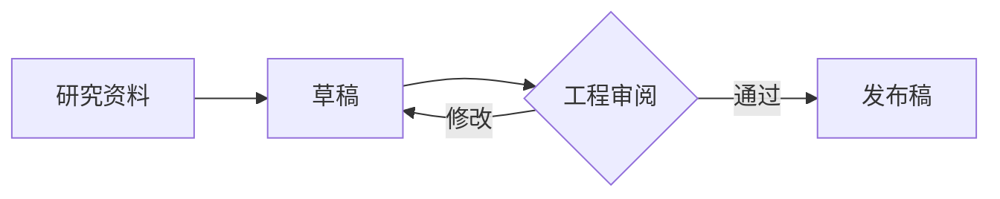
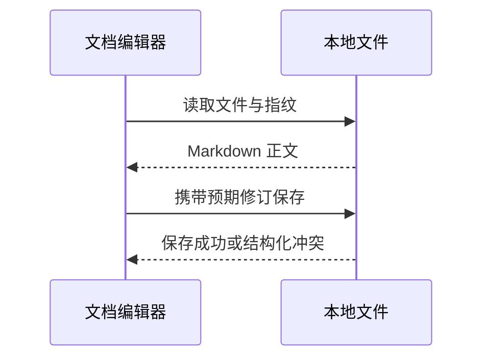

# 本地高级 Markdown 工作台

本页用于核对可视化、源码往返与导出。权威内容仍是这份 Markdown 文件。

## 数学公式

平差残差的标准差为 $\sigma_0=\sqrt{\frac{v^TPv}{n-u}}$，单位权中误差来源见注释[^accuracy]。

$$
\begin{aligned}
\hat{x} &= (A^T P A)^{-1} A^T P l \\
\Sigma_{\hat{x}} &= \sigma_0^2 (A^T P A)^{-1}
\end{aligned}
$$

矩阵、分式与求和：

\[
Q = \begin{bmatrix}1 & 0.2 \\ 0.2 & 2\end{bmatrix},\qquad
s = \sum_{i=1}^{n} \frac{w_i x_i}{\sum_j w_j}
\]

```math
\int_0^1 x^2\,dx=\frac{1}{3}
```

源码字面量 `$x$`、价格 $20 和转义符号 \$ 保持为普通文本。

## 本地脚注

脚注支持重复引用[^accuracy]、另一条说明[^review]与行内说明^[此说明是行内脚注，不写入单独的协作服务。]。

[^accuracy]: 示例公式用于软件验收，**不代表工程项目的真实计算成果**。公式中的 $n-u$ 为自由度。

    同一脚注可包含第二段说明和 [本地索引](./index.md)。

正文仍可在脚注定义之间继续编辑，后面的引用保持对应关系[^review]。

[^review]: 导出前审阅来源、单位与有效数字。脚注回链应返回正文引用位置。

## Mermaid 流程图



## Mermaid 时序图



## 原始 HTML 与代码

```html
<div class="example">&lt;literal&gt; &amp; &#x27;</div>
```

原始 HTML/MDX 仍采用源码保护；公式、脚注和图表使用“编辑源码”按钮并在对话框中实时预览。
